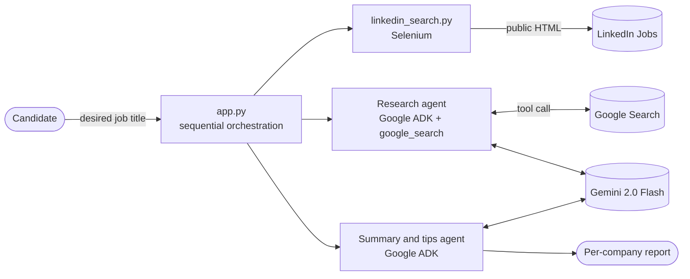
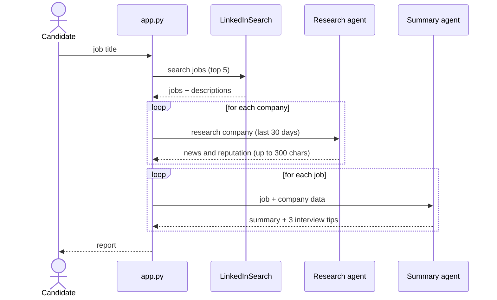

# 🤖 ai-find-job-flow

A multi-agent pipeline that, given a job title, collects job postings, researches the companies' reputation and generates a summary with interview tips. Built with **Google ADK**, **Gemini** and **Selenium**.

## 🏗️ Architecture

### Overview



### Flow



### Components

| Component | Responsibility |
|---|---|
| `app.py` | Orchestrates the flow and wraps agent execution (`call_agent`, in-memory session) |
| `linkedin_search.py` | Collects jobs and descriptions via Selenium |
| `glassdoor_search.py` | Reviews collector (available, **not** part of the main flow) |
| Research agent | Uses the ADK `google_search` tool for recent news |
| Summary agent | Synthesizes job + company into a summary and 3 tips |

## 🧭 Architecture decisions

| Decision | Rationale | Trade-off |
|---|---|---|
| Specialized agents with short instructions | Single responsibility; prompts are easy to tune | More LLM calls (cost/latency) |
| **Sequential** orchestration in Python | Simple and predictable for a linear flow | No parallelism or retries; companies are processed one by one |
| `google_search` as an agent tool | Fresh data without maintaining a own datastore | Quality depends on search results |
| `InMemorySessionService` | Zero infrastructure | No persistence between runs |

## ⚠️ Limitations and caveats

- LinkedIn/Glassdoor scraping relies on fragile CSS selectors and may **violate those services' terms of use**. For real usage, prefer official APIs or authorized providers.
- No handling for rate limits, CAPTCHAs or retries.
- The summary comes from search results and may contain inaccuracies; sources are not verified.
- The model name is hard-coded (`gemini-2.0-flash`), although `MODEL_ID` is required as an environment variable.

## 🚀 Roadmap

- [ ] Replace scraping with authorized sources (jobs API)
- [ ] Run per-company research in parallel (ADK `ParallelAgent`)
- [ ] Structured output (Pydantic) and source citations in the report
- [ ] Automated evaluation of tip quality
- [ ] Observability (tracing, tokens, cost) and research caching
- [ ] Tests and CI with GitHub Actions

## ▶️ Running locally

Prerequisites: Python 3.10+, Google Chrome + a matching ChromeDriver.

```bash
git clone https://github.com/dgmodesto/ai-find-job-flow.git
cd ai-find-job-flow
pip install -r requirements.txt
```

Set the environment variables:

```env
GOOGLE_API_KEY=xxx
MODEL_ID=gemini-2.0-flash
```

```bash
python app.py
```

## 📄 Sample output

```markdown
--- Braskem ---
Braskem faces recent market challenges, but is well rated by its employees.

1. Show awareness of the current petrochemical market.
2. Highlight your problem-solving ability.
3. Emphasize collaborative values.
```

## 🛠️ Stack

Python · Google ADK · Gemini · Selenium

## 📜 License

MIT — see `LICENSE`.

Built by [Douglas Modesto](https://www.linkedin.com/in/douglasmodesto)
