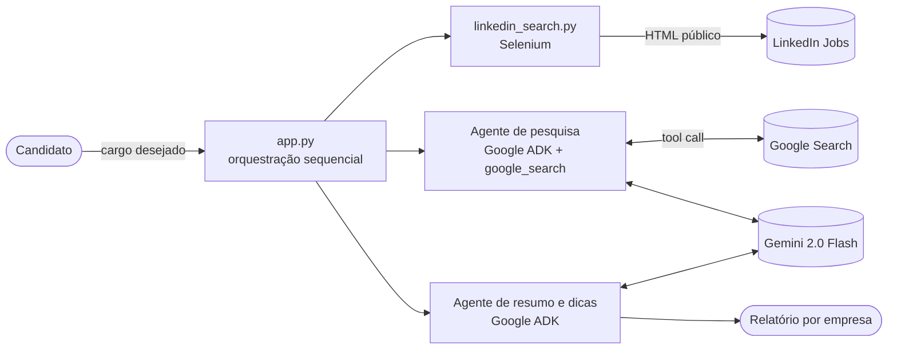
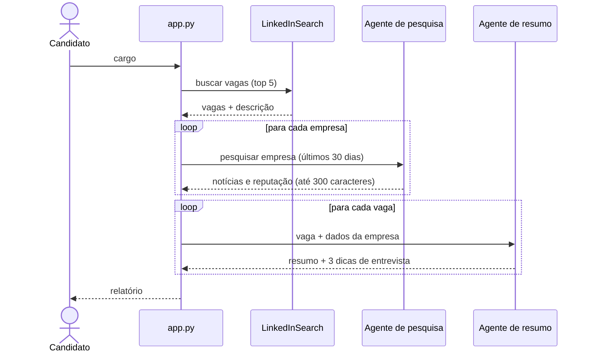

# 🤖 ai-find-job-flow

Pipeline multi-agente que, a partir de um cargo, coleta vagas, pesquisa a reputação das empresas e gera um resumo com dicas de entrevista. Construído com **Google ADK**, **Gemini** e **Selenium**.

## 🏗️ Arquitetura

### Visão geral



### Fluxo



### Componentes

| Componente | Responsabilidade |
|---|---|
| `app.py` | Orquestra o fluxo e encapsula a execução de agentes (`call_agent`, sessão em memória) |
| `linkedin_search.py` | Coleta vagas e descrições via Selenium |
| `glassdoor_search.py` | Coletor de avaliações (disponível, **não** está no fluxo principal) |
| Agente de pesquisa | Usa a ferramenta `google_search` do ADK para notícias recentes |
| Agente de resumo | Sintetiza vaga + empresa em um resumo e 3 dicas |

## 🧭 Decisões de arquitetura

| Decisão | Motivo | Trade-off |
|---|---|---|
| Agentes especializados com instruções curtas | Responsabilidade única e prompts fáceis de ajustar | Mais chamadas ao LLM (custo/latência) |
| Orquestração **sequencial** em Python | Simples e previsível para um fluxo linear | Sem paralelismo nem retentativas; empresas são processadas uma a uma |
| `google_search` como ferramenta do agente | Dados recentes sem manter base própria | Qualidade depende dos resultados da busca |
| `InMemorySessionService` | Zero infraestrutura | Sem persistência entre execuções |

## ⚠️ Limitações e pontos de atenção

- O scraping do LinkedIn/Glassdoor depende de seletores CSS frágeis e pode **violar os termos de uso** desses serviços. Para uso real, prefira APIs oficiais ou provedores autorizados.
- Não há tratamento de limites de taxa, *captcha* ou retentativas.
- O resumo vem de resultados de busca e pode conter imprecisões; não há checagem de fontes.
- O nome do modelo está fixo no código (`gemini-2.0-flash`), embora `MODEL_ID` seja exigido como variável de ambiente.

## 🚀 Roadmap

- [ ] Substituir scraping por fontes autorizadas (API de vagas)
- [ ] Executar a pesquisa por empresa em paralelo (`ParallelAgent` do ADK)
- [ ] Saída estruturada (Pydantic) e citação das fontes no relatório
- [ ] Avaliação automatizada da qualidade das dicas
- [ ] Observabilidade (tracing, tokens, custo) e cache de pesquisas
- [ ] Testes e CI com GitHub Actions

## ▶️ Como executar

Pré-requisitos: Python 3.10+, Google Chrome + ChromeDriver compatível.

```bash
git clone https://github.com/dgmodesto/ai-find-job-flow.git
cd ai-find-job-flow
pip install -r requirements.txt
```

Configure as variáveis de ambiente:

```env
GOOGLE_API_KEY=xxx
MODEL_ID=gemini-2.0-flash
```

```bash
python app.py
```

## 📄 Exemplo de resultado

```markdown
--- Braskem ---
A Braskem enfrenta desafios recentes de mercado, mas é bem avaliada por seus funcionários.

1. Demonstre conhecimento do cenário atual do setor petroquímico.
2. Destaque sua capacidade de resolver problemas.
3. Enfatize valores de colaboração.
```

## 🛠️ Stack

Python · Google ADK · Gemini · Selenium

## 📜 Licença

MIT — veja `LICENSE`.

Desenvolvido por [Douglas Modesto](https://www.linkedin.com/in/douglasmodesto)
